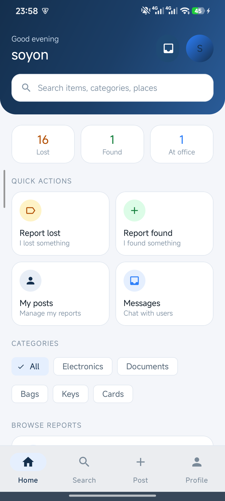
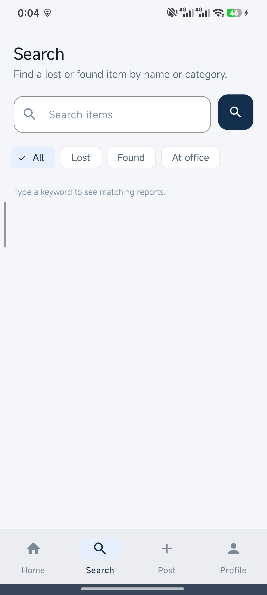
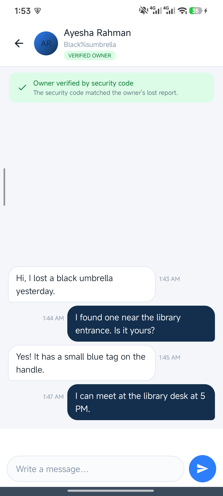
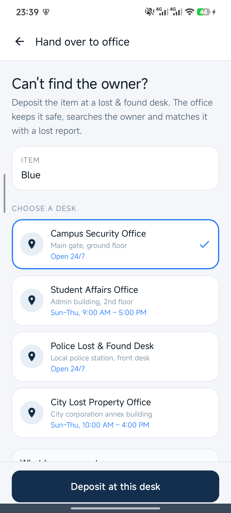

# FindLink — Lost and Found

An Android application that reconnects people with the things they lose on a campus. Anyone can report a lost item or a found item, talk to the other side in real time, and prove ownership with a code the app itself issues — so an item is only handed over to the person it actually belongs to.

**Course:** CSE-2200 Advanced Programming Laboratory, Khulna University of Engineering & Technology
**Author:** Soyon Chandra Das — Roll 2307116

---

## Features

| Area | What it does |
|---|---|
| Reports | Post a lost or found item with photo (camera or gallery), category, place and date |
| Discovery | Home dashboard with live counters, search with All / Lost / Found / At office filters |
| Chat | Real-time two-way messaging per item, conversation inbox, unread badges, "Seen" ticks |
| Ownership | Every **lost** report gets an app-issued 6-digit security code; the finder verifies it inside the chat and the claimant is marked `VERIFIED OWNER` |
| Lost & found desk | If the owner cannot be traced, the finder deposits the item at a desk; the app stores a receipt code (`FL-0000AA`) and the desk details |
| Accounts | Firebase email/password auth, profile always shows name + Gmail |

## Screenshots

| Home | Search & filters | Verified chat | Office deposit |
|---|---|---|---|
|  |  |  |  |

## Tech stack

- **Language / UI:** Java, AndroidX, Material Components 3
- **SDK:** min 24, target 36 (edge-to-edge on Android 15)
- **Auth:** Firebase Authentication (email & password)
- **Database:** Cloud Firestore — snapshot listeners, transactions, batched writes
- **Images:** imgbb REST API v1 (upload) + Glide (display)
- **Camera / gallery:** `ActivityResultContracts.TakePicture` with `FileProvider`, `ActivityResultContracts.GetContent`
- **Build:** AGP 9.2.1, Gradle 9.4.1, Firebase BOM

## Getting started

1. Clone the repository and open it in Android Studio.
2. `app/google-services.json` is committed so the demo build runs as-is. For your own Firebase project, replace it with the file from **Firebase Console → Project settings → Your apps**.
3. Create `local.properties` in the project root if it does not exist:

   ```properties
   sdk.dir=/path/to/Android/Sdk
   IMGBB_API_KEY=your_imgbb_api_key
   ```

   The key is read through `BuildConfig.IMGBB_API_KEY` and is **never** committed. Without it, posting a photo fails but the rest of the app still works.
4. Build and install:

   ```bash
   ./gradlew assembleDebug
   adb install -r app/build/outputs/apk/debug/app-debug.apk
   ```

## Data model (Cloud Firestore)

```
users/{uid}                 name, email, createdAt
items/{itemId}              userId, reportType (LOST|FOUND), title, category, place, date,
                            imageUrl, status (ACTIVE|AT_OFFICE|RESOLVED),
                            securityCode + securityHash (lost reports only),
                            office*, depositCode, depositedBy, depositedAt
chats/{chatId}              participants[], itemId, itemTitle, lastMessage, lastMessageAt,
                            lastSenderId, lastRead{uid: timestamp}, verifiedOwnerId
chats/{chatId}/messages/{id} senderId, text, createdAt, verified
```

The chat id is deterministic (`itemId__uidA__uidB`), so both users always land in the same thread. Message + chat summary are written in one `WriteBatch`, and the chat document is created inside a transaction.

## How ownership verification works

1. A lost report is created → the app generates a 6-digit code, shows it only to the owner, and stores `sha256(itemId + ":" + code)`.
2. A finder opens the chat and presses the lock button, then asks the claimant for the code.
3. The finder types the code; `ClaimVerifier` compares the hash and, on success, writes `verifiedOwnerId` so both sides see `VERIFIED OWNER`.
4. Codes exist only for **lost** reports. Found reports rely on messages and photo proof instead.

## Project structure

```
app/src/main/java/com/example/findlink/
├── activities/     MainActivity, LoginActivity, ChatActivity, ItemDetailsActivity,
│                   ClaimActivity, OfficeDepositActivity, AddPostActivity, ProfileActivity
├── fragments/      Home, Search, AddPost, Inbox, Profile
├── adapters/       ItemAdapter, ChatAdapter, ConversationAdapter, InboxAdapter
├── models/         ItemModel, ChatMessage, ConversationModel, UserModel, Office
└── util/           ChatRepository, ClaimVerifier, SecurityCode, ClaimCode, DepositCode,
                    ImgbbUploader, UserProfileSync, OfficeDirectory, WindowInsetsUtil
app/src/androidTest/  instrumented tests against the real Firebase project
```

## Tests

Instrumented tests run on a device against Firebase:

```bash
./gradlew assembleDebugAndroidTest
adb shell am instrument -w \
  -e class com.example.findlink.ChatImprovementTest \
  com.example.findlink.test/androidx.test.runner.AndroidJUnitRunner
```

Covered: security-code hashing and claims (`SecurityCodeTest`, `ClaimVerifierTest`, `OwnerVerifyTest`), chat atomicity and unread state (`ChatImprovementTest`), office deposit receipts (`OfficeDepositTest`), profile sync (`ProfileSyncTest`).

## Project report

The full project report is in [`report/FindLink-Project-Report-With-Cover.docx`](report/FindLink-Project-Report-With-Cover.docx) (12 pages, includes architecture, API/database design, screenshots and references).
